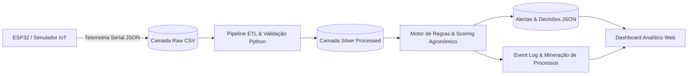

# AgroSmart — Centro Integrado de Operações & Decisão Agronômica

Plataforma autônoma e completa de **IoT Agrícola**, **Processamento Analítico de Dados**, **Motor de Regras Inteligentes**, **Mineração de Processos (Process Mining)**, **Pipeline DevSecOps** e **Apresentação de Produto (Pitch)**.

---

## 1. Visão Geral da Solução

O **AgroSmart** foi desenvolvido como uma solução de engenharia ponta a ponta para resolver um dos maiores gargalos do agronegócio moderno: o desperdício de até 40% da água de irrigação e as quebras de safra decorrentes de estiagens e estresse térmico identificados tardiamente.

A plataforma conecta microcontroladores **ESP32** (físicos ou simulados) a um pipeline determinístico em Python que valida dados com 100% de conformidade, avalia riscos agronômicos multivariáveis, aciona comandos de irrigação, audita o fluxo via **Process Mining** e publica indicadores em um **Dashboard Web** local e responsivo.



---

## 2. Estrutura do Repositório

```text
agro-smart/
├── .github/workflows/
│   └── devsecops.yml           # Pipeline CI/CD automatizado (Lint, SAST, Testes, Docker)
├── dashboard/
│   ├── index.html              # Interface do Dashboard (6 módulos integrados)
│   ├── style.css               # Estilos modernos e responsivos
│   ├── app.js                  # Lógica interativa, gráficos e simulador do ESP32
│   └── data.js                 # Dataset analítico consolidado e publicado
├── data/
│   ├── raw/
│   │   └── sensor_readings.csv # Camada Raw: leituras brutas de 48h (3 talhões)
│   ├── processed/
│   │   └── telemetry_processed.csv # Camada Silver: dados higienizados e tipados
│   └── output/
│       ├── alerts.json         # Decisões e alertas automatizados
│       ├── dashboard_summary.json # Resumo analítico com métricas
│       ├── event_log.csv       # Event Log padronizado para Process Mining (946 evts)
│       ├── process_mining_insights.json # Análise de variantes e gargalos
│       ├── health_status.json  # Relatório de status e healthcheck do sistema
│       └── agrosmart_system.log # Logs estruturados contínuos em formato logfmt
├── docs/
│   ├── arquitetura.md          # Especificação da arquitetura em 5 camadas
│   ├── coleta_e_sensores.md    # Detalhamento dos sensores e simulação Wokwi
│   ├── processamento_e_automacao.md # Regras de negócio e cálculo de risco
│   ├── dashboard_indicadores.md # Guia dos indicadores e KPIs da plataforma
│   ├── pipeline_devsecops.md   # Documentação da esteira DevSecOps e segurança
│   ├── analise_processos.md    # Relatório detalhado de Mineração de Processos
│   └── monitoramento.md        # Arquitetura de observabilidade e healthcheck
├── evidencias/
│   ├── arquitetura_integrada.png # Diagrama de arquitetura da plataforma
│   ├── arquitetura_detalhada.png # Diagrama expandido com contratos de dados
│   ├── simulacao_sensores.png  # Telemetria e simulação visual do ESP32
│   ├── wokwi_circuito.png      # Circuito eletrônico montado no Wokwi
│   ├── dashboard_visao_geral.png # Visão geral de KPIs e gráfico de umidade
│   ├── dashboard_automacao.png # Matriz de regras e log de ações
│   ├── process_mining_map.png  # Mapa DFG com variantes e gargalos
│   ├── devsecops_execution_log.txt # Evidência de execução da auditoria DevSecOps
│   └── monitoramento_logs.txt  # Evidência de ciclos de monitoramento e logs
├── simulator/
│   ├── agrosmart_esp32.ino     # Firmware C++ para o microcontrolador ESP32
│   ├── diagram.json            # Esquema de conexões elétricas para o Wokwi
│   ├── libraries.txt           # Bibliotecas do Arduino/ESP32 (DHT sensor library)
│   └── wokwi.toml              # Arquivo de inicialização do simulador Wokwi
├── src/
│   ├── pipeline.py             # Pipeline ETL e motor de decisões agronômicas
│   ├── simulate_sensors.py     # Gerador determinístico de telemetria IoT
│   ├── process_mining.py       # Extração de Event Log e análise de processos
│   ├── monitor.py              # Observabilidade, logs estruturados e healthcheck
│   └── run_all.py              # Orquestrador da execução completa ponta a ponta
├── tests/
│   └── test_pipeline.py        # Bateria de testes automatizados (unittest)
├── tools/
│   ├── run_devsecops.py        # Runner automatizado de auditoria DevSecOps
│   ├── build_presentation.py   # Gerador do arquivo PowerPoint (.pptx)
│   ├── build_report.py         # Compilador do Relatório Oficial (.docx)
│   └── convert_word.ps1        # Script PowerShell de conversão para PDF
├── Dockerfile                  # Container Alpine seguro com usuário non-root
├── docker-compose.yml          # Orquestração do serviço com healthcheck e limites
├── requirements.txt            # Dependências do projeto
└── README.md                   # Documentação mestre do projeto
```

---

## 3. Instruções de Execução Rápida

### Requisitos
- **Python:** 3.11 ou superior
- **Docker:** Opcional (necessário caso execute via contêiner)

### Modo 1: Execução Completa com Python (Recomendado)

Abra o terminal (PowerShell, Bash ou CMD) na raiz do projeto e execute:

```powershell
# 1. Executar o fluxo completo (Simulação, Pipeline, Process Mining e Healthcheck):
python src/run_all.py

# 2. Iniciar o Dashboard Web:
python -m http.server 8080 --directory dashboard
```

Acesse no navegador: **`http://localhost:8080`**

*Caso a porta 8080 esteja ocupada, utilize outra porta:*
```powershell
python -m http.server 8766 --directory dashboard
# Acessar http://localhost:8766
```

---

### Modo 2: Execução com Container Docker

O contêiner foi construído sob boas práticas de **Container Hardening** (usuário não-root `appuser`, probe nativo de healthcheck a cada 10s e limites de recursos):

```powershell
docker compose up --build
```

Acesse no navegador: **`http://localhost:8080`**

Para parar o contêiner:
```powershell
docker compose stop
```

---

## 4. Pipeline DevSecOps & Testes de Qualidade

A plataforma implementa uma esteira completa de segurança e qualidade de código com aprovação integral em todos os Quality Gates.

### Como executar a auditoria DevSecOps automatizada:

```powershell
python tools/run_devsecops.py
```

O comando executa automaticamente:
1. **Qualidade de Código (flake8):** Verificação estrita de conformidade com PEP 8 (`flake8 src tests --max-line-length=120`). Resultado: **0 erros**.
2. **Segurança SAST (Bandit):** Análise estática contra vulnerabilidades OWASP / CWE (`bandit -r src`). Resultado: **0 vulnerabilidades**.
3. **Bateria de Testes Automatizados (unittest):** Executa 6 testes unitários validando regras agronômicas, mineração de processos e monitoramento. Resultado: **6/6 aprovados**.
4. **Auditoria de IaC:** Valida usuário non-root no Dockerfile e probes de healthcheck.

A evidência auditável é persistida em: [`evidencias/devsecops_execution_log.txt`](evidencias/devsecops_execution_log.txt).

### Como executar apenas os testes unitários:

```powershell
python -m unittest discover -s tests -v
```

Saída esperada:
```text
test_combined_heat_and_drought_is_critical ... ok
test_health_monitoring_metrics ... ok
test_irrigation_is_triggered_for_dry_soil_without_rain ... ok
test_process_mining_event_log_and_variants ... ok
test_rain_forecast_postpones_irrigation ... ok
test_simulator_output_passes_validation ... ok
----------------------------------------------------------------------
Ran 6 tests in 0.001s - OK
```

---

## 5. Monitoramento Contínuo & Observabilidade

O subsistema [`src/monitor.py`](src/monitor.py) assegura a execução contínua e a saúde operacional da solução:

- **Logs Estruturados:** Gravados em formato *logfmt* em [`data/output/agrosmart_system.log`](data/output/agrosmart_system.log).
- **Indicador de Saúde:** Arquivo JSON em [`data/output/health_status.json`](data/output/health_status.json) com taxa de conformidade (100%), vazão (> 800 rec/s) e latência de ciclo (~160 ms).
- **Comando para múltiplos ciclos contínuos:**
  ```powershell
  python src/monitor.py --cycles 3 --delay 0.5
  ```

---

## 6. Análise de Processos (Process Mining)

A solução transforma os dados agronômicos em um **Event Log** padronizado com 946 eventos e 11 atividades distintas, exportado em [`data/output/event_log.csv`](data/output/event_log.csv).

- **Variantes Mapeadas:** 5 variantes de processo (Nominal 43,1%, Atenção 31,2%, Irrigação Crítica 18,1%, Economia Chuva 4,2%, Estresse Térmico 3,5%).
- **Gargalo Identificado:** A atividade `Decisao_Ativar_Irrigacao` consome 320 ms devido ao handshake de atuadores hidráulicos.
- **Oportunidade de Otimização:** Transição para mensageria assíncrona (MQTT) e inferência de emergência na borda (ESP32).
- **Visualização do DFG:** Gráfico gerado em [`evidencias/process_mining_map.png`](evidencias/process_mining_map.png).

---