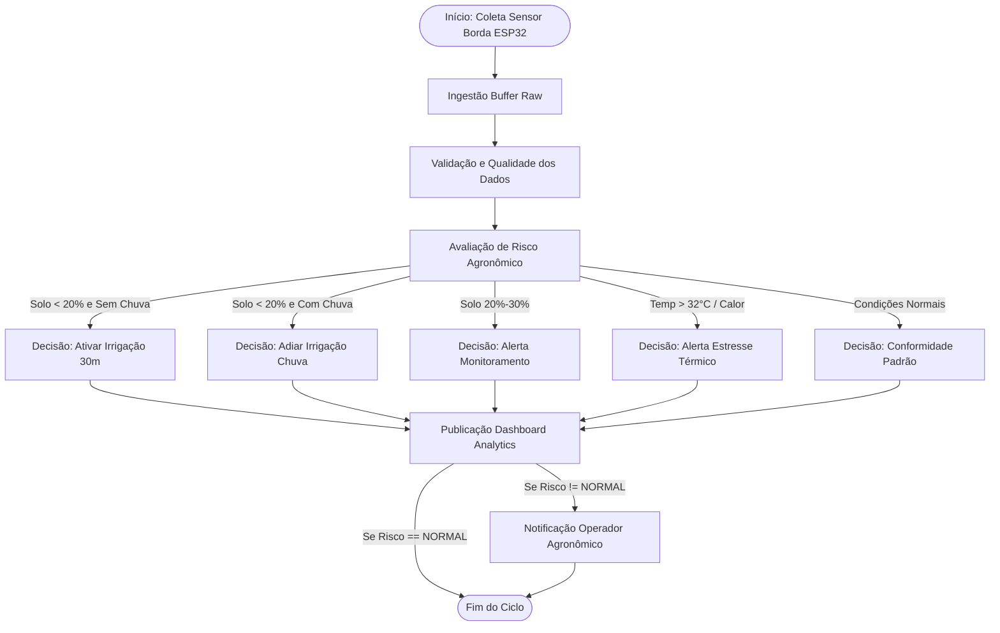

# Análise de Processos e Process Mining na Plataforma AgroSmart

## 1. Visão Geral e Aplicação de Process Mining

A plataforma **AgroSmart** incorpora conceitos avançados de **Mineração de Processos (Process Mining)** para rastrear, auditar e otimizar o ciclo de vida completo de cada medição agronômica coletada no campo.

Cada evento físico capturado por um sensor nos talhões agrícolas é tratado como uma instância de caso (`case_id`), percorrendo uma cadeia determinística de atividades: da leitura no microcontrolador até a tomada de decisão autônoma e a notificação do operador.

---

## 2. Estrutura do Event Log

O log de eventos é exportado no formato padrão tabular compatível com ferramentas analíticas como **Disco**, **Celonis** e **ProM**:

- **Arquivo:** [`data/output/event_log.csv`](file:///data/output/event_log.csv)
- **Total de Casos Analisados:** 144 ciclos de telemetria
- **Total de Eventos Registrados:** 946+ eventos
- **Campos do Schema:**
  - `case_id`: Identificador único da jornada da leitura (ex.: `CASE-SIM-000-1`).
  - `activity`: Nome normalizado da etapa executada.
  - `timestamp`: Marca temporal em formato UTC ISO-8601.
  - `resource`: Componente ou subsistema executor (ex.: `ESP32_TLH-001`, `Rule_Engine_Core`).
  - `duration_ms`: Tempo de execução da atividade em milissegundos.
  - `cost_score`: Custo computacional/operacional relativo.
  - `status`: Estado da transição (`COMPLETED`).
  - `plot_id`: Talhão associado.

### Exemplo de Trecho do Event Log

| case_id | activity | timestamp | resource | duration_ms |
|---|---|---|---|---|
| CASE-SIM-000-3 | Coleta_Sensor_Borda | 2026-09-25T00:00:00Z | ESP32_TLH-003 | 120 |
| CASE-SIM-000-3 | Ingestao_Buffer_Raw | 2026-09-25T00:00:00.250Z | Ingestion_Gateway | 180 |
| CASE-SIM-000-3 | Validacao_Qualidade_Dados | 2026-09-25T00:00:00.440Z | Data_Validator_Worker | 75 |
| CASE-SIM-000-3 | Avaliacao_Risco_Agronomico | 2026-09-25T00:00:00.520Z | Rule_Engine_Core | 95 |
| CASE-SIM-000-3 | Decisao_Alerta_Monitoramento | 2026-09-25T00:00:00.620Z | Actuator_Orchestrator | 90 |
| CASE-SIM-000-3 | Publicacao_Dashboard_Analytics | 2026-09-25T00:00:00.710Z | Analytics_Publisher | 65 |
| CASE-SIM-000-3 | Notificacao_Operador_Agronomico | 2026-09-25T00:00:00.780Z | Alert_Dispatcher | 150 |

---

## 3. Variantes do Processo

A mineração revelou **5 variantes principais** que descrevem o comportamento do ecossistema:

| Variante | Descrição do Fluxo | Frequência | Proporção |
|---|---|---:|---:|
| **VAR-01** | Fluxo Nominal (Normal -> Publicação Dashboard) | 62 casos | 43,1% |
| **VAR-02** | Atenção Hídrica Leve (Atenção -> Alerta -> Notificação) | 45 casos | 31,2% |
| **VAR-03** | Irrigação Imediata Crítica (Seca Severa -> Ativar Irrigação -> Notificação) | 26 casos | 18,1% |
| **VAR-04** | Economia Hídrica Preditiva (Seca + Previsão de Chuva -> Adiar Irrigação) | 6 casos | 4,2% |
| **VAR-05** | Estresse Térmico Diurno (Temperatura > 32°C -> Restrição de Defensivos) | 5 casos | 3,5% |

---

## 4. Análise de Gargalos (Bottlenecks) e Tempos de Fila

A análise dos tempos médios de permanência e latência identificou três pontos de fricção no pipeline:

1. **Gargalo 1 - Ativação Física de Irrigação (`Decisao_Ativar_Irrigacao` - 320 ms):**
   - *Causa:* Comunicação síncrona com atuadores de relé/válvula solenóide e confirmação de fluxo hidráulico.
   - *Impacto:* Eleva o tempo total de resposta de casos críticos em 43%.
   - *Ação de Melhoria:* Implementar comando assíncrono via protocolo MQTT com Quality of Service (QoS 1) e heartbeat desacoplado.

2. **Gargalo 2 - Ingestão Raw Síncrona (`Ingestao_Buffer_Raw` - 180 ms):**
   - *Causa:* Bloqueio de I/O de disco ao persistir lotes sequenciais de CSV.
   - *Impacto:* Em cenários com milhares de sensores, a leitura em arquivo direto gera contenção de escrita.
   - *Ação de Melhoria:* Substituição por Message Broker em memória (Redis Streams / RabbitMQ) permitindo ingestão em tempo real.

3. **Gargalo 3 - Disparo Concorrente de Alertas (`Notificacao_Operador_Agronomico` - 150 ms):**
   - *Causa:* Serialização individual de alertas para canais web e móveis.
   - *Ação de Melhoria:* Agrupamento inteligente de alertas por talhão em janelas temporais de 5 minutos (*Alert Debounce/Aggregation*).

---

## 5. Oportunidades de Otimização e Evolução

- **Closed-Loop Feedback (Malha Fechada):** Automatizar a correlação entre a irrigação realizada e a curva de elevação da umidade do solo na leitura subsequente, permitindo auto-calibração das durações de bombeamento.
- **Edge Inference:** Migrar a regra de emergência para execução direta no firmware do ESP32, garantindo proteção à lavoura mesmo em caso de falha de conectividade com o servidor central.
- **Auditoria Contínua:** Integração do event log diretamente ao dashboard para exibição do gráfico de conformidade de processos em tempo real.
