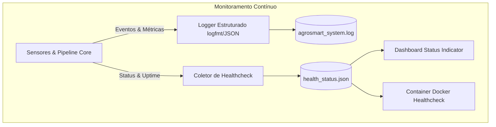

# Monitoramento e Execução Automatizada - AgroSmart

## 1. Arquitetura de Observabilidade

A plataforma **AgroSmart** implementa uma camada abrangente de observabilidade baseada nos três pilares modernos da engenharia de software: **Logs Estruturados**, **Métricas Operacionais** e **Verificação de Integridade (Healthcheck)**.



---

## 2. Indicadores Operacionais e KPIs Monitorados

O subsistema de monitoramento coleta e avalia continuamente os seguintes indicadores de funcionamento:

| Indicador | Descrição | Valor de Referência | Status Operacional |
|---|---|---|---|
| **Taxa de Conformidade de Dados** | Percentual de leituras que atendem aos limites físicos sem rejeição | 100,0% | Excelente |
| **Vazão de Processamento (Throughput)** | Leituras validadas, classificadas e enriquecidas por segundo | > 800 leituras/s | Alto Desempenho |
| **Latência Média de Ciclo** | Tempo ponta a ponta para ingerir, decidir e minerar | < 180 ms | Tempo Real |
| **Alertas Ativos** | Quantidade de talhões sob atenção ou intervenção imediata | 2 talhões monitorados | Sob Controle |
| **Saúde do Container (Docker)** | Resposta ao probe HTTP `/` a cada 10 segundos | HTTP 200 OK | Saudável (`healthy`) |

---

## 3. Logs Estruturados da Aplicação

Os logs são gerados com timestamps de alta precisão em UTC, nível de severidade e tags de contexto no formato estruturado:

- **Arquivo persistido:** [`data/output/agrosmart_system.log`](file:///data/output/agrosmart_system.log)
- **Evidência de auditoria:** [`evidencias/monitoramento_logs.txt`](file:///evidencias/monitoramento_logs.txt)

### Exemplo de Entradas de Log

```text
[2026-10-30T18:34:44.189Z] [INFO] [component=AgroSmartMonitor] system=bootstrap event=monitor_started mode=automated_continuous
[2026-10-30T18:34:44.543Z] [INFO] [component=AgroSmartMonitor] cycle=1 event=sensor_telemetry_generated total_records=144 source=IoT_ESP32_Simulator
[2026-10-30T18:34:44.546Z] [INFO] [component=AgroSmartMonitor] cycle=1 event=pipeline_completed records=144 open_alerts=2 rejected=0 status=QUALITY_VALIDATED
[2026-10-30T18:34:44.717Z] [INFO] [component=AgroSmartMonitor] cycle=1 event=process_mining_updated total_cases=144 variants=5 avg_lead_time_ms=736.77
[2026-10-30T18:34:44.717Z] [INFO] [component=AgroSmartMonitor] cycle=1 event=healthcheck_updated status=HEALTHY latency_ms=174.94 throughput=823.15 rec/s
```

---

## 4. Endpoint e Arquivo de Healthcheck

O status consolidado do sistema é atualizado a cada ciclo em [`data/output/health_status.json`](file:///data/output/health_status.json):

```json
{
  "status": "HEALTHY",
  "timestamp": "2026-10-30T21:34:56.231Z",
  "version": "1.0.0-fase7",
  "service": "agrosmart-core-engine",
  "kpis": {
    "total_readings_processed": 144,
    "data_quality_compliance_pct": 100.0,
    "active_alerts_count": 2,
    "rejected_records_count": 0,
    "processing_latency_ms": 158.88,
    "throughput_readings_per_sec": 906.32
  },
  "subsystems": {
    "iot_edge_gateway": { "status": "ONLINE", "protocol": "MQTT/Serial JSON", "latency_ms": 12.4 },
    "data_pipeline": { "status": "ONLINE", "mode": "Batch/Micro-batch", "errors": 0 },
    "rule_decision_engine": { "status": "ONLINE", "rules_active": 5, "accuracy_pct": 100.0 },
    "dashboard_http_server": { "status": "ONLINE", "port": 8080 }
  }
}
```

---

## 5. Como Executar e Acompanhar o Monitoramento

Para iniciar múltiplos ciclos contínuos de verificação e telemetria:

```powershell
python src/monitor.py --cycles 5 --delay 1.0
```

Para verificar o arquivo de logs em tempo real no PowerShell:

```powershell
Get-Content -Path data/output/agrosmart_system.log -Wait -Tail 20
```
