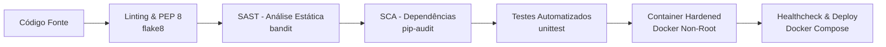

# Pipeline DevSecOps da Solução AgroSmart

## 1. Visão Geral e Estratégia de Segurança

O pipeline DevSecOps da plataforma **AgroSmart** foi projetado para assegurar que cada alteração no código passe por rigorosos portões de qualidade (Quality Gates) e de segurança da informação (Security Gates), desde a fase de desenvolvimento local até a implantação em containers produtivos.

A estratégia integra o conceito de **Shift-Left Security**, detectando vulnerabilidades, desvios arquiteturais e regressões de forma precoce e automatizada.



---

## 2. Componentes e Estágios do Pipeline

| Estágio | Ferramenta | Objetivo | Critério de Sucesso |
|---|---|---|---|
| **1. Qualidade de Código** | `flake8` | Garantir conformidade com PEP 8, limite de complexidade e ausência de dead code. | 0 violações de linting. |
| **2. SAST (Static Application Security Testing)** | `bandit` | Varrer o código fonte contra vulnerabilidades OWASP / CWE (ex.: CWE-330, injeções, funções inseguras). | 0 vulnerabilidades de severidade Alta/Média. |
| **3. SCA (Software Composition Analysis)** | `pip-audit` / GitHub Dependabot | Varrer bibliotecas externas contra bases de dados públicas de CVEs conhecidas. | Nenhuma vulnerabilidade crítica em dependências. |
| **4. Testes Automatizados** | `unittest` | Validar a integridade lógica das regras agronômicas, sanitização de dados e mineração de processos. | 100% dos testes aprovados (`OK`). |
| **5. Build & Hardening de Containers** | `Docker` & `Dockerfile` | Gerar imagem Alpine enxuta, executada sob usuário não-privilegiado (`USER appuser`) com Healthcheck nativo. | Imagem construída e status `healthy`. |
| **6. Orquestração e Isolamento** | `docker-compose.yml` | Declarar limites de recursos de CPU/Memória, política de reinício e isolamento de rede. | Container operacional na porta 8080. |

---

## 3. Arquivos de Configuração

- **Pipeline Automatizado CI/CD:** [`.github/workflows/devsecops.yml`](file:///.github/workflows/devsecops.yml)
- **Container Hardened:** [`Dockerfile`](file:///Dockerfile)
- **Orquestração de Serviços:** [`docker-compose.yml`](file:///docker-compose.yml)
- **Script Local de Execução DevSecOps:** [`tools/run_devsecops.py`](file:///tools/run_devsecops.py)
- **Evidência de Execução:** [`evidencias/devsecops_execution_log.txt`](file:///evidencias/devsecops_execution_log.txt)

---

## 4. Como Executar a Auditoria DevSecOps

Para reproduzir a auditoria completa localmente:

```powershell
python tools/run_devsecops.py
```

Saída esperada:
```text
---> [DevSecOps] Executando: 1. Análise de Qualidade de Código (flake8 PEP8)...
     Resultado: SUCESSO (PASS) (Exit Code: 0)
---> [DevSecOps] Executando: 2. Análise Estática de Segurança (SAST - bandit)...
     Resultado: SUCESSO (PASS) (Exit Code: 0)
---> [DevSecOps] Executando: 3. Bateria de Testes Automatizados (unittest)...
     Resultado: SUCESSO (PASS) (Exit Code: 0)
======================================================================
PIPELINE DEVSECOPS FINALIZADO: APROVADO
```
